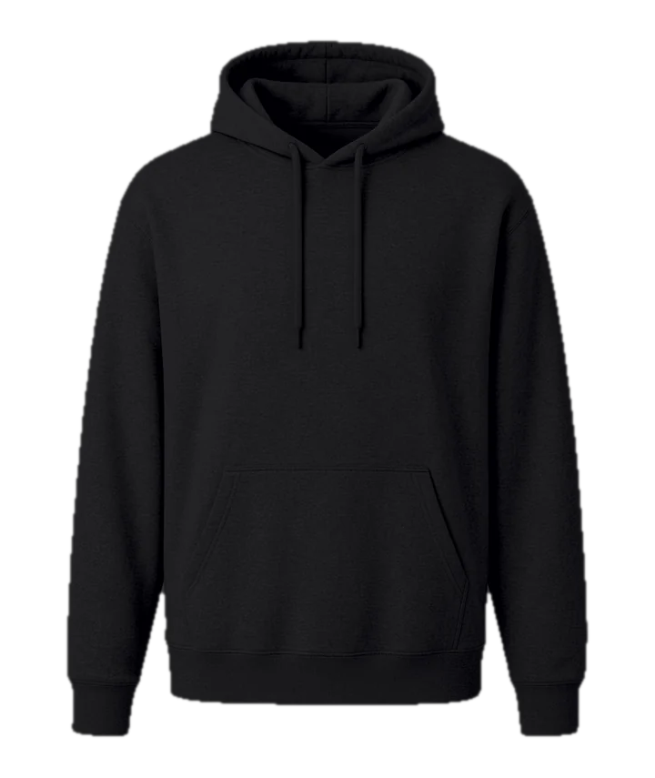

# AGENTS.md — Rhinocult Dropshipping

Instructions for any AI coding agent (Cursor, Claude, ChatGPT, Copilot, etc.) working in this repo.
Read `llm.md` first for brand, copy and design context.

## What this project is

A static marketing website for **Rhinocult Dropshipping**, the private-label / print-on-demand arm of
[Rhino Cult](https://rhinocult.com) (Indian streetwear brand). Clothing brand owners use it to start
a brand without holding inventory: Rhinocult makes custom t-shirts, hoodies, sweatshirts, baby tees,
tank tops and cut & sew pieces under the client's label and ships to their customers.

- Layout reference: https://unitee.in (dark, bold, alternating image/check-list sections, pill buttons).
- Brand and asset reference: https://rhinocult.com (logo, product photos, socials, WhatsApp number).
- Conversion goals (only two): **WhatsApp chat** and **Book a Call**. There is no cart, checkout,
  login, backend or database.

## Stack

- Plain HTML + CSS + vanilla JS. No framework, no build step, no npm dependencies.
- Google Fonts: `Unbounded` (display/headings) and `Inter` (body), loaded via `<link>` in each page.

## File map

| Path | Purpose |
| --- | --- |
| `index.html` | Landing page: hero, marquee, products, features, how it works, street banner, lookbook, FAQ, CTA, footer, floating WhatsApp button |
| `book-a-call.html` | Booking form. On submit it opens WhatsApp with the details prefilled |
| `styles.css` | All styles. Design tokens are CSS variables in `:root` at the top |
| `script.js` | WhatsApp number config, `data-wa` link builder, mobile menu, booking form logic |
| `assets/img/` | Optimised WebP images taken from rhinocult.com, plus `favicon.png` |
| `assets/img/catalog/` | 36 transparent garment photos, one per product colour (`<product>-<colour>.webp`) |
| `llm.md` | Portable brand/content/design brief for any LLM |

## Run locally

```bash
cd rhinocult-dropshipping
python3 -m http.server 8080
# open http://localhost:8080
```

Opening `index.html` directly from the file system also works.

## How WhatsApp links work (important)

- The number lives in one place: `CONFIG.whatsappNumber` in `script.js` (country code + digits, no `+`).
- Any element with `data-wa="Some message"` gets its `href` rewritten to
  `https://wa.me/<number>?text=<encoded message>` on page load.
- Each such link also has a plain `href="https://wa.me/916362990365"` fallback for no-JS visitors.
  **If you change the number, update `CONFIG.whatsappNumber` and search/replace `916362990365` in the
  HTML files**, and update the visible footer number `+91 63629 90365`.
- To add a new WhatsApp CTA: `<a href="https://wa.me/916362990365" data-wa="Hi Rhinocult, ..." target="_blank" rel="noopener">`.

## Product cards (collection section)

Source of truth for products, colours, hex codes, GSM and sizes: the RhinoCult 2027 catalogue
(summarised in `llm.md` section 2). Each card in `#products` looks like:

```html
<article class="product-card" data-product="Hoodie" data-specs="330 GSM polycotton fleece · Regular fit, unisex · S–XXL">
  
  <strong data-colour-name>Black</strong>
  <div class="swatches" role="radiogroup">
    <button class="swatch" role="radio" aria-checked="true" style="--swatch: #1B1B1E"
            data-colour="Black" data-img="assets/img/catalog/hoodie-black.webp"></button>
    ...
  </div>
  <a class="btn btn-solid btn-block product-cta" href="https://wa.me/916362990365" data-wa="...">Customize now</a>
</article>
```

`script.js` wires every `.product-card[data-specs]`: clicking a swatch sets `aria-checked`, swaps the
image and colour label, and rewrites the CTA to a WhatsApp message with product, colour and specs.

- Add a colour: export a transparent 720×855 WebP (same recolour recipe as `llm.md` section 8) to `assets/img/catalog/<product>-<colour>.webp` and
  add a `.swatch` button. Add class `swatch-acid` for acid-wash shades. Update the colour count text.
- Add a product: copy a whole `<article>`; set `data-product` (singular name) and `data-specs`.
- Swatch hex values are product data and are the only allowed inline colours.
- Cargo Pants data comes from Rhino Cult's Myntra listings (black only), not the catalogue.

## Book a Call flow

`book-a-call.html` → form validates with native HTML constraints → `script.js` builds a multi-line
message (name, brand, phone, products, date, slot, notes) → opens WhatsApp in a new tab. Nothing is
stored. To switch to Calendly/Google Calendar/Cal.com later, replace the form or the submit handler;
keep the WhatsApp button as a fallback.

## Conventions

- Keep it static and dependency-free unless the owner asks otherwise.
- Reuse existing classes: `.btn .btn-solid|.btn-outline|.btn-sm|.btn-block`, `.section`, `.section-head`,
  `.eyebrow`, `.checks`, `.product-card`, `.feature` / `.feature-reverse`, `.steps`, `.faq details`.
- Colours, fonts, radius and container width come from `:root` variables. Do not hard-code new colours.
- Images: WebP, max ~1000px wide (cut-outs ~900px, banner 1600px), `loading="lazy"` below the fold,
  always set `width`, `height` and meaningful `alt`.
- Mobile breakpoints: 1024px, 860px (menu collapses to hamburger), 640px.
- Copy voice: short, bold, confident, Indian English. Prices in INR (Rs.) if ever added.
- Keep both pages' `<head>` (fonts, favicon, theme colour) and header/footer consistent.

## Claims to confirm with the owner before going live

Unitee is a layout reference only; never copy its wording. These offer points were not confirmed
for Rhinocult. Edit them in
`index.html` (features + FAQ) if they are not accurate:

- No minimum order quantity / pay only when you sell.
- Shopify store integration.
- COD support and fast COD payouts.
- Custom neck labels, tags and packaging; orders ship under the client's brand.
- Returns management, fast dispatch, dedicated POC.
- Booking call length (15–20 min) and the time slots (10 AM – 8 PM).

Facts that ARE confirmed by the 2027 catalogue (safe to use): product range, colours, GSM, fits and
sizes; in-house screen/puff/DTF/DTG/sublimation/embroidery; 3,000 pcs/day; Nelamangala, Bengaluru
unit; PAN India dispatch; 500+ brands, 500+ corporate orders, 5,000+ products delivered.

Official address (footer `<address>`, from https://rhinocult.com/pages/contact and
https://corporate.rhinocult.com): 1838, Jayamahal, Taluk Office Road, Opp. Deepasri Hostel,
Nelamangala, Bengaluru Rural, Karnataka 562123. The catalogue's "No. 2500, Market Road" address is wrong.

Policy links in the footer point to rhinocult.com's retail policies. Replace them with dropshipping-
specific policies when available.

## Deploy

Any static host works: Netlify (drag and drop the folder), Vercel (framework preset "Other"),
Cloudflare Pages, GitHub Pages, or Shopify page embed. No environment variables are needed.

## Verify before finishing a change

1. Serve locally and load `/` and `/book-a-call.html` without console errors.
2. Check desktop (1440px) and mobile (390px) widths; open and close the mobile menu.
3. On a product card, pick a swatch: the image and colour label change, and **Customize now** opens
   WhatsApp with product, colour and specs. Other CTAs must also carry an encoded prefilled message.
4. Submit the booking form empty (error shows) and filled (WhatsApp opens with all fields).
